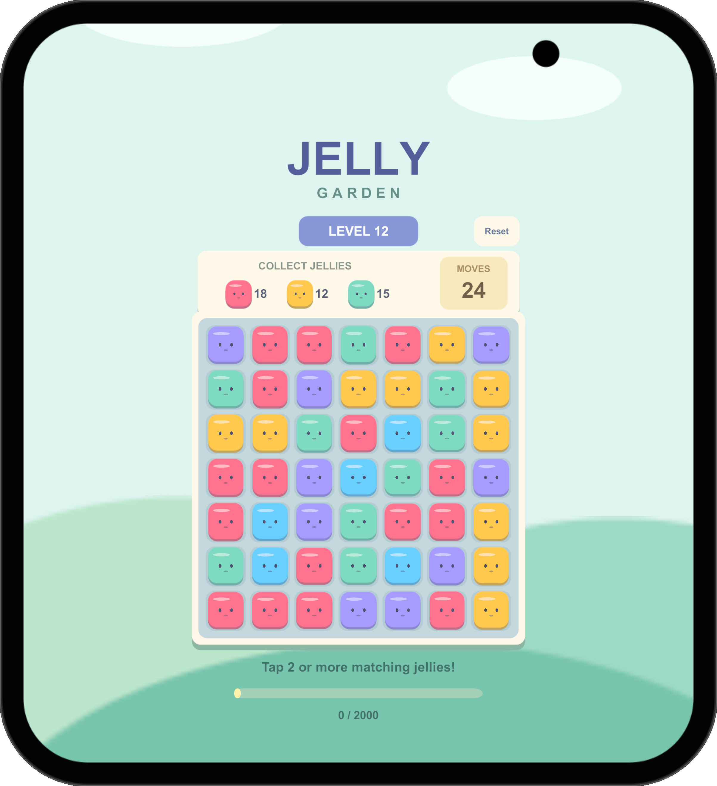
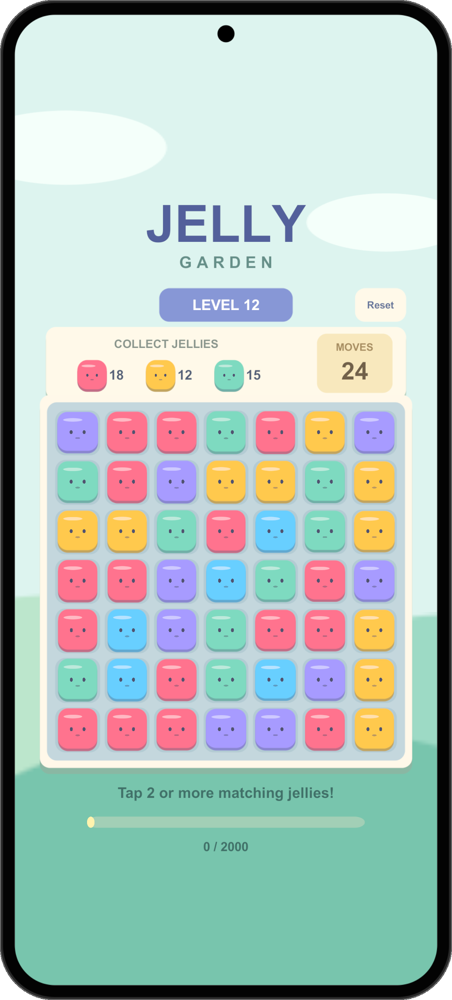

# Jelly Garden on foldable screens

Fresh framed captures from **Unity 6000.6.5f1**, recorded **2026-10-26** using the
original playable Jelly Garden sample. These are real Simulator profile renders,
not physical-device photographs. Each pair shows separately rendered screens.

**iPhone Duo leads this showcase.** The hero and primary gameplay/screen-switch
GIFs use Duo; the remaining devices demonstrate additional catalog coverage.

[Back to the feature tour](../README.md)

## iPhone Duo — featured device

| Inner screen | Outer screen |
| :---: | :---: |
|  |  |

## Pixel 10 Pro Fold

| Inner screen | Outer screen |
| :---: | :---: |
|  |  |

## Galaxy Z Flip8

| Inner screen | Outer screen |
| :---: | :---: |
|  |  |

## Galaxy Z Fold8

| Inner screen | Outer screen |
| :---: | :---: |
|  |  |

## Galaxy Z Fold8 Ultra

| Inner screen | Outer screen |
| :---: | :---: |
|  |  |

## OPPO Find N5

| Inner screen | Outer screen |
| :---: | :---: |
|  |  |

## Recording notes

The seven refreshed GIFs contain **180 frames over 15 seconds**, played at **12 fps**.
Gameplay and screen switching come from successive real Unity Simulator
captures through the tool's framed PNG export path, preserving the actual device
surround and camera/notch masks. Playback timing is edited; no intermediate game
frames are synthesized.

Search, filter, favorite, export and comparison tours combine fresh desktop UI captures
with a separately recorded gameplay pane. Both panes are labelled. They are instructional
edits, not continuous desktop video; the tool actions and game moves are not synchronized.

The native gallery screenshot is a real window capture. The sample report contains 11
snapshots on iPhone 16 and Pixel Fold inner/outer profiles. Every snapshot checked 329
objects with zero geometric issues and zero skipped objects. Full-screen scenery is
outside the selected audit root. Geometry checks do not assess usability or readability.

[Media metadata](assets/demos/recordings.json) ·
[Actual report](assets/demos/puzzle-audit/report.json) ·
[HTML and original PNGs](assets/demos/puzzle-audit/index.html)

The old intentional-overflow fixture remains in `assets/demos/ui-audit-report` as
historical regression evidence; it is not the new puzzle showcase.

Device surrounds retain their separate [third-party terms](../THIRD_PARTY_NOTICES.md).
