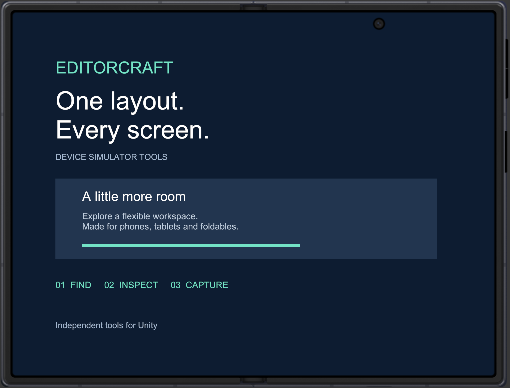
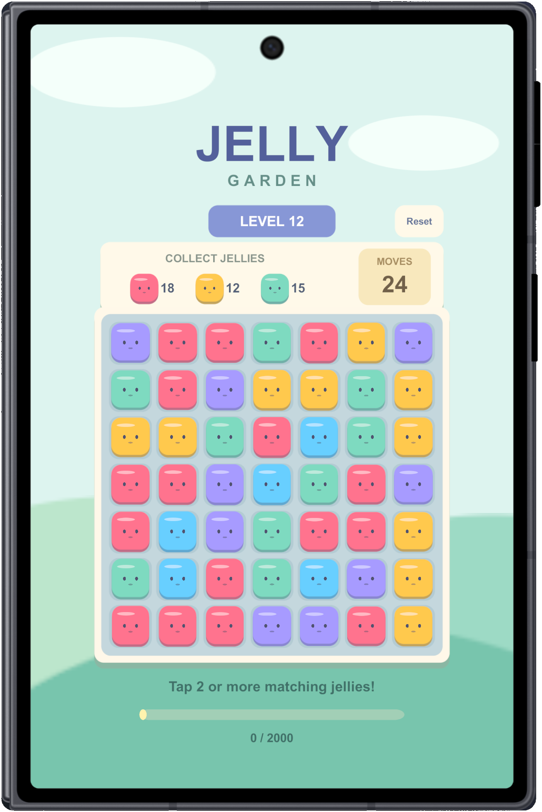
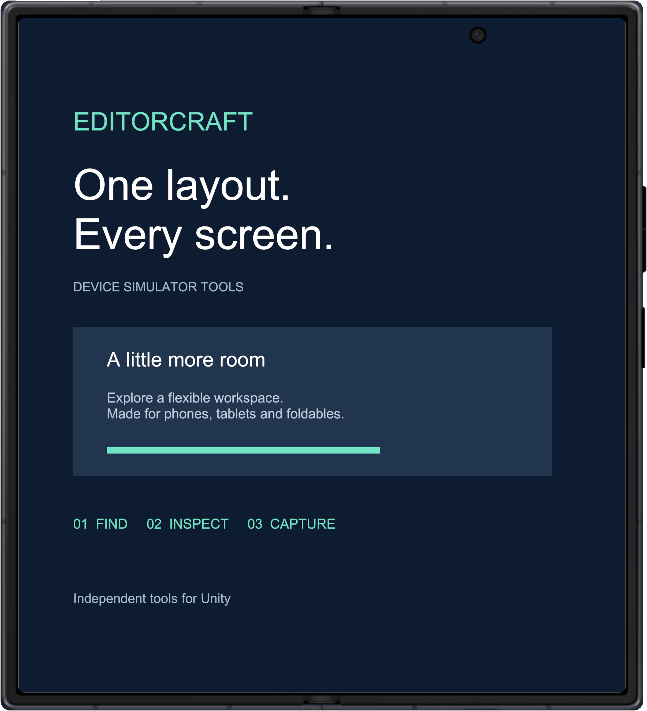
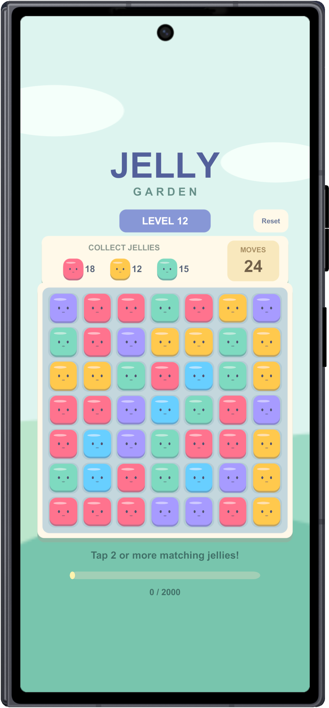

# EditorCraft tools and foldable showcase

**Supported and tested: Unity 2022.3.62f2 (2022 LTS) and Unity 6 (6000.6.5f1).** Supports both the older LTS generation and Unity 6; other Editor patches require validation.

## See the tools in action

Short, looping demos captured from the actual **Unity 2022.3.62f2** plugin panel.
Timing is edited for readability; screenshot results are real exported PNGs.

### Search by model

### Filter by platform and device type

### Save and filter favorites

### Export clean and framed screenshots

### Batch capture favorites into an HTML gallery

Star the screens you want, then choose **Test Tools → Capture selected favorites…**.
The batch honors the current search and filters and creates `index.html` plus a PNG
for each matching favorite. Device and orientation are restored after capture.
The final GIF frame arranges the actual exported PNGs for comparison; it is not a
browser screenshot. [Open the example HTML gallery](assets/demos/favorite-gallery/index.html)
from a local checkout (GitHub displays the HTML source).

### Switch inner and outer displays

Use **Outer ↔ / Inner ↔** in the plugin panel to switch the paired Pixel 10 Pro Fold
profiles. This shows actual Simulator viewport changes, not a hinge animation.

Open **Control Panel → EditorCraft Device Tools** to use the picker, then
**Test Tools** for screenshots and **Capture selected favorites…** for an HTML gallery.
These demos show Simulator profiles, not measurements of physical devices.

## Foldable captures

Captured on 2026-10-25 in Unity 6000.6.5f1 with the package framed PNG exporter.
The original neutral UI was rendered in a temporary additive scene; no unrelated
application content was used. Full-resolution screen and device pixels are preserved. The exterior gray preview
backing was removed using the exporter’s boundary-connected transparency mask.
These are profile simulations, not physical-device measurements.

### iPhone Duo

Click **Inner ↔ / Outer ↔** to switch Duo displays. Recorded in Unity with the
EditorCraft demo layout; this loop shows two real screen states, not a hinge animation.

| Inner screen | Outer screen |
| :---: | :---: |
|  |  |

### Pixel 10 Pro Fold

| Inner screen | Outer screen |
| :---: | :---: |
|  |  |

### Galaxy Z Fold8

| Inner screen | Outer screen |
| :---: | :---: |
|  |  |

### Galaxy Z Fold8 Ultra

| Inner screen | Outer screen |
| :---: | :---: |
|  |  |

### Galaxy Z Flip8

| Inner screen | Outer screen |
| :---: | :---: |
|  |  |

## Artwork scope

The demo layout is original. Device frame artwork retains the provenance and unresolved
redistribution status documented in [Third-party notices](../THIRD_PARTY_NOTICES.md).
The screenshots are not blanket MIT-licensed images. Resolve this before public release.
