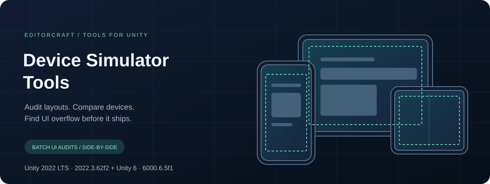
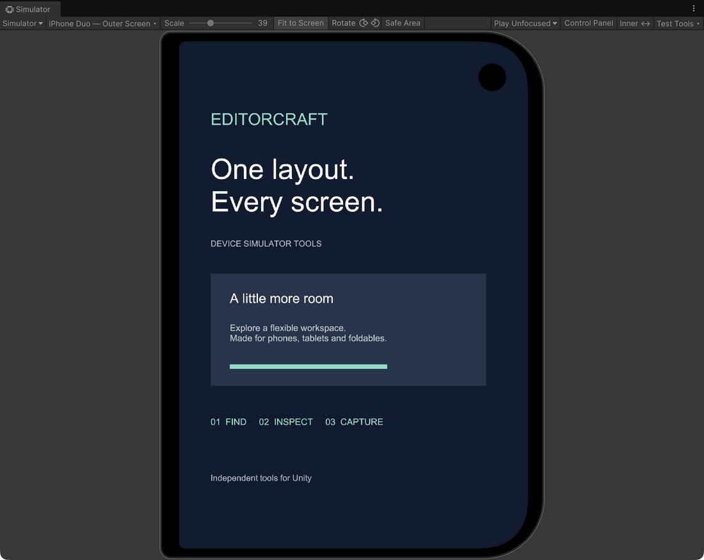
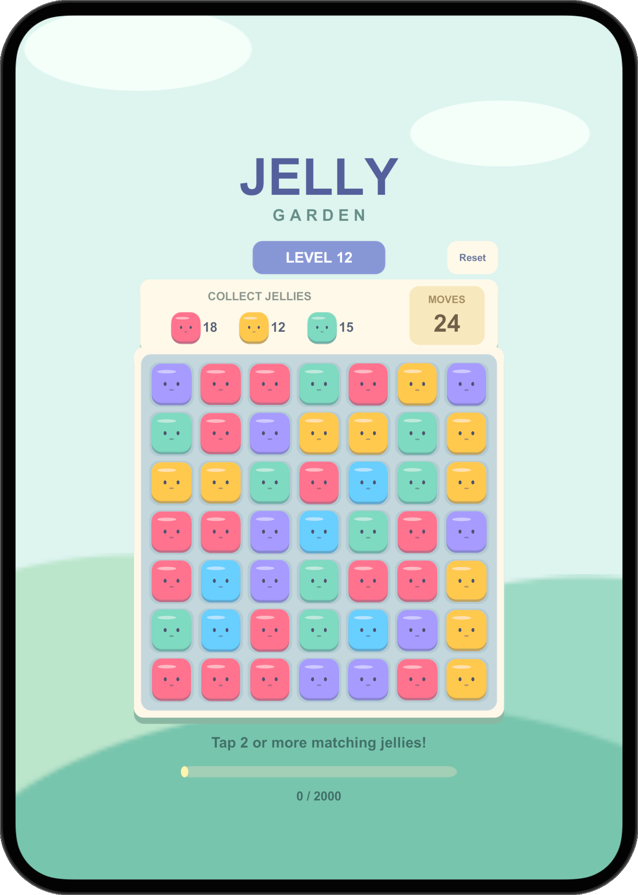
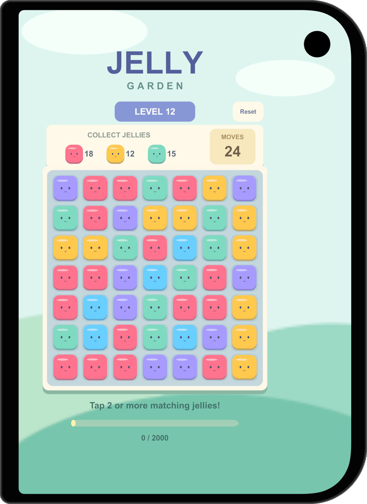
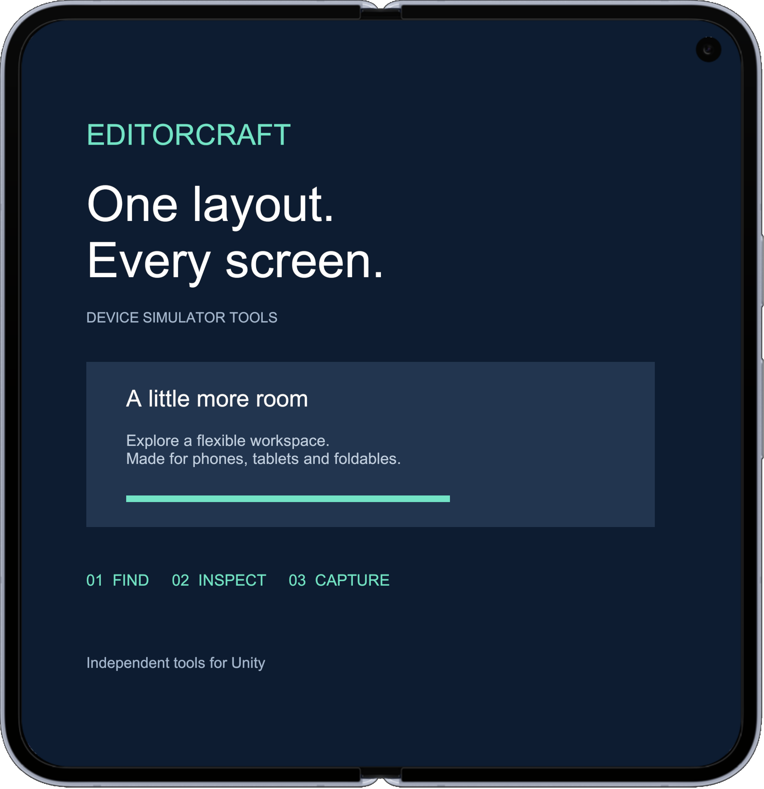
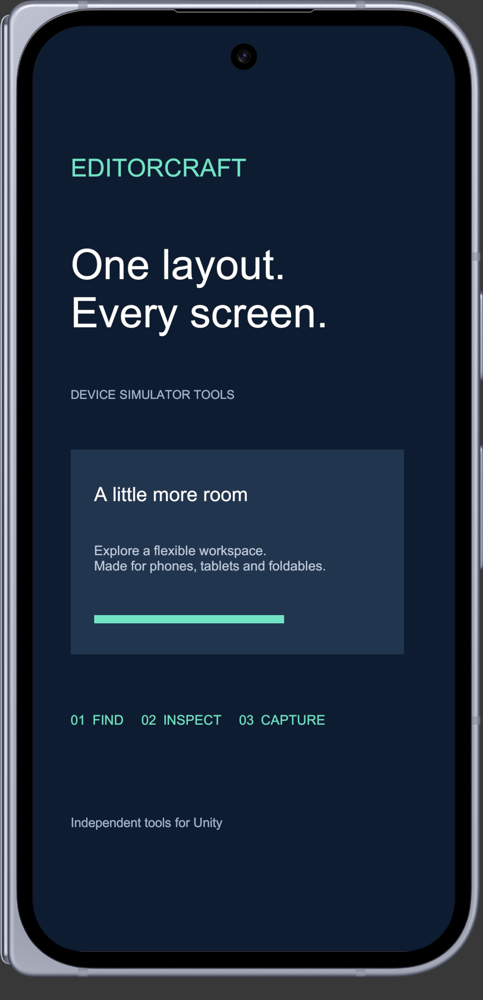
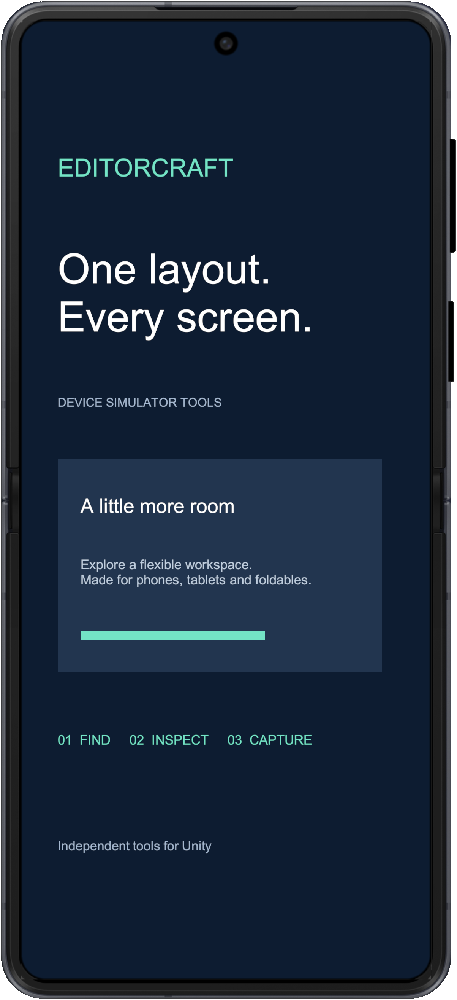
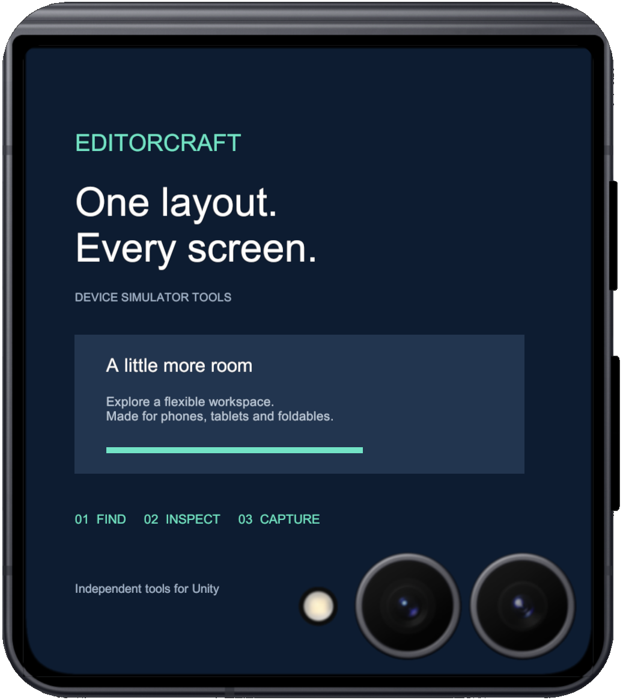

<p align="center">
  
</p>

<p align="center">
  <strong>EditorCraft · Device Simulator Tools</strong><br />
  Independent tools for Unity. Built for the details.
</p>

<p align="center">
  
  
  
  
</p>

<p align="center">
  <a href="#the-workflow">The workflow</a> ·
  <a href="#get-started">Get started</a> ·
  <a href="#compatibility">Compatibility</a> ·
  <a href="CONTRIBUTING.md">Contributing</a> ·
  <a href="#license-and-credits">License</a>
</p>

---

The first tool in the **EditorCraft** collection, Device Simulator Tools extends Unity's Device Simulator with a compact device picker,
local favorites, paired foldable screens, PNG capture and a safe-area inspector.
Built and maintained by [Daghan Demirci](https://github.com/dghn).

> **v0.1.0** · Verified with Unity 6000.6.5f1.
> [Release notes](https://github.com/dghn/editorcraft-device-simulator-tools/releases/tag/v0.1.0) · [Installation verification](Documentation~/INSTALL_VERIFICATION.md).

The banner is an original schematic illustration, not a screenshot of the tool.

## Device coverage

**122 maintained screen profiles · 117 model names · 5 foldable pairs**

| Catalog | Screen profiles |
| --- | ---: |
| Apple | 89 |
| Android | 33 |
| Total custom profiles | **122** |

Inner and outer screens count as separate profiles, not separate physical devices.
The five paired models are iPhone Duo, Pixel 10 Pro Fold, Galaxy Z Fold8,
Galaxy Z Fold8 Ultra and Galaxy Z Flip8. Model-name counts merge these pairs;
this is a catalog count, not a claim of physical-device testing.

With Unity's bundled catalog and presets, the last verified picker contained **186
selectable entries** on Unity 6000.6.5f1. That includes presets and may change with the
registry catalog; it does not mean 186 distinct hardware models.

[Browse the maintained device list](Documentation~/DEVICES.md).

## Foldable showcase

Real framed PNG captures from Unity 6000.6.5f1, using an original English-only
EditorCraft demo layout. These are Simulator profile renders, not photographs of
physical devices or screenshots of manufacturer software. Inner and outer screens
are rendered separately.

### iPhone Duo



Click **Inner ↔ / Outer ↔** to switch Duo displays. Recorded in Unity with the
EditorCraft demo layout; this loop shows two real screen states, not a hinge animation.

| Inner screen | Outer screen |
| :---: | :---: |
|  |  |

### Pixel 10 Pro Fold

| Inner screen | Outer screen |
| :---: | :---: |
|  |  |

### Galaxy Z Flip8

| Inner screen | Outer screen |
| :---: | :---: |
|  |  |

[View all five foldable pairs](Documentation~/SHOWCASE.md), including Galaxy Z Fold8 and Fold8 Ultra.

These captures include the existing manufacturer-derived frames and remain subject
to the same [publication restrictions](THIRD_PARTY_NOTICES.md).

## The workflow

### 01 — Find the right screen

Search devices by name. Combine iOS/Android and Phone/Tablet/Foldable filters.
Star the devices you revisit. Search, filters and favorites stay local and persist
between sessions. The picker prefers maintained profiles over matching bundled names
while leaving Unity's registry catalog unchanged.

### 02 — Inspect the layout

Read pixel insets and view the safe-area boundary. Select an active screen-space UI
RectTransform to compare its bounds against that boundary. Switch between paired
inner and outer foldable profiles from the Simulator toolbar.

### 03 — Capture and compare

Export a clean PNG or include the device frame. Capture the favorites matching your
current filters into an HTML gallery. Output folders are remembered locally; each
export gets a collision-safe name. Batch completion or cancellation restores the
original device and orientation, and completed captures remain available.

| Capability | Included today |
| --- | --- |
| Device catalog | 89 Apple and 33 Android custom screen profiles |
| Picker | Search, platform/type filters, favorites, keyboard navigation |
| Foldables | Paired inner/outer profile switching |
| Captures | Clean/framed PNG, orientation handling, sequential batch gallery |
| Layout inspection | Safe-area insets and selected screen-space UI bounds |
| Package scope | Editor-only assembly, installed through UPM |

## Get started

**Local package:** open a separate Unity **6000.6.5f1** project. In Package Manager,
choose **Install package from disk** and select this repository's `package.json`.
Then open **Window → General → Device Simulator** and use the picker and **Test Tools**.
Keep Simulator active and rendering before capturing. This repository is a UPM
package; do not open it as a Unity project.

**Git installation:** open **Window → Package Management → Package Manager**,
click **+ → Install package from Git URL**, and paste:

```text
https://github.com/dghn/editorcraft-device-simulator-tools.git#v0.1.0
```

Git must be installed locally. Public HTTPS installation needs no GitHub account or
SSH key. The URL is pinned to v0.1.0; use `#main` only to follow development.


UPM resolves the Unity device catalog, Newtonsoft JSON and uGUI dependencies.
The installed tool does not require the Unity CLI or Pipeline. The repository root is the
package. No host scene or Unity project settings are included. `Documentation~`
contains the GitHub presentation and provenance; Unity skips importing that folder.

### One command for coding agents

Run this from the **target Unity project root** (the folder containing `Assets`,
`Packages` and `ProjectSettings`). Requires Python 3.9+ and Git. No GitHub account or SSH key is needed. Use Bash/zsh on macOS/Linux or PowerShell with `python3`
available on Windows. Close Unity while editing its manifest, then reopen it.

```sh
python3 -c 'import os, pathlib, subprocess, sys, tempfile; url=os.environ.get("EDITORCRAFT_GIT_URL", "https://github.com/dghn/editorcraft-device-simulator-tools.git"); tmp=tempfile.TemporaryDirectory(prefix="editorcraft-"); repo=pathlib.Path(tmp.name)/"package"; subprocess.run(["git", "clone", "--depth", "1", "--branch", "v0.1.0", url, str(repo)], check=True); subprocess.run([sys.executable, str(repo/"Tools~"/"install.py"), "--project", os.getcwd(), "--url", url+"#v0.1.0"], check=True)'
```

This clones the installer into a temporary directory and registers the Git dependency
in `Packages/manifest.json`. Other dependencies and manifest fields are preserved.
It saves an exact backup as `Packages/manifest.json.editorcraft-backup`, leaves an
identical installation unchanged, and stops on a conflicting dependency or embedded
package. It does not copy this repository into `Assets`, modify project settings,
or edit `packages-lock.json`. Unity resolves dependencies when the project opens.
Manifest registration is not confirmation that UPM resolution or compilation passed.

For a dedicated SSH alias, set `EDITORCRAFT_GIT_URL` to
`ssh://git@github-dghn/dghn/editorcraft-device-simulator-tools.git` before running the
command. In Bash/zsh you can prefix the command with
`EDITORCRAFT_GIT_URL=ssh://git@github-dghn/dghn/editorcraft-device-simulator-tools.git`.
In PowerShell set `$env:EDITORCRAFT_GIT_URL` first. The value is the repository URL
without a `#ref`; this installer uses `v0.1.0`.

If the repository is already cloned, use the installer directly:

```sh
python3 "/path/to/editorcraft-device-simulator-tools/Tools~/install.py" --project "/path/to/UnityProject"
```

Coding agents: run the command only in the intended project, inspect the manifest
diff, then let Unity resolve the package and check the Console for compilation
errors. Report those results separately. Do not claim success from the manifest
change alone. The package needs no agent plugin, Unity CLI or Pipeline installation.

Clean-project Git installation, dependency resolution and Editor compilation were
verified on 2026-10-25 at commit `18449199b852`.
[Read the verification report](Documentation~/INSTALL_VERIFICATION.md) for evidence and scope.

## Compatibility

The package declares Unity 6000.6 and has been verified in **6000.6.5f1**. It relies
on internal Simulator APIs; other Editor versions need separate validation.

- Safe areas describe recorded OS/system-UI configurations, not universal hardware values.
- UI inspection checks rectangular bounds, not visible pixels or clipping.
- Batch capture is sequential while the application runs, not a frozen replay or automated visual test.
- Foldable profiles simulate one screen at a time.
- Capture requires a ready Simulator render.

## Inside the repository

| Path | Purpose |
| --- | --- |
| `package.json` | UPM identity, version and dependencies |
| `Editor/` | Editor tooling, profiles and overlays |
| `Documentation~/` | Device list, screenshots and provenance |
| `Tools~/` | Agent-friendly manifest installer (not imported by Unity) |
| `.github/` | Contribution templates and static integrity workflow |

Run the offline integrity check with Python 3.9+:

```sh
python3 .github/scripts/validate_package.py
```

The development Unity host and regeneration tools are maintained separately and are
not part of this repository. Static validation complements the recorded clean Git installation and Editor checks. See the [release checklist](Documentation~/RELEASE_CHECKLIST.md).

## License and credits

Original editor tooling and maintainer scripts use [MIT](LICENSE.md).
Manufacturer-derived artwork and third-party materials are excluded from that grant;
read [Third-party notices](THIRD_PARTY_NOTICES.md) before redistribution.
The original repository banner is also available under MIT.

An independent tool for Unity. Not affiliated with or endorsed by Unity or device manufacturers.
