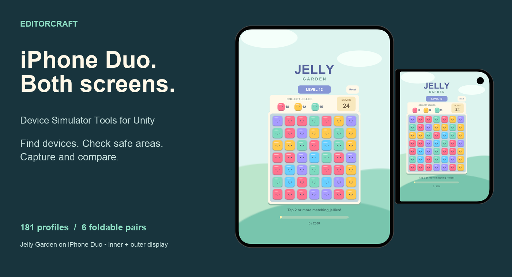
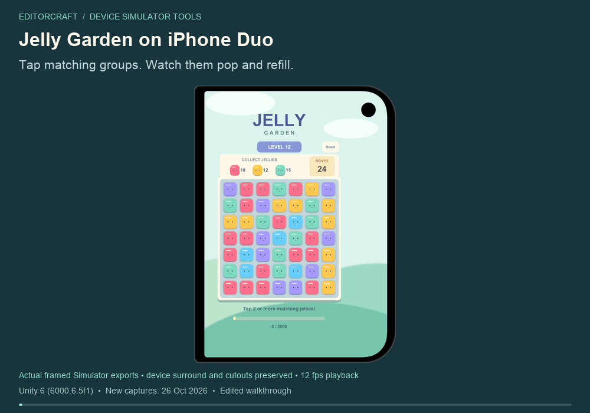
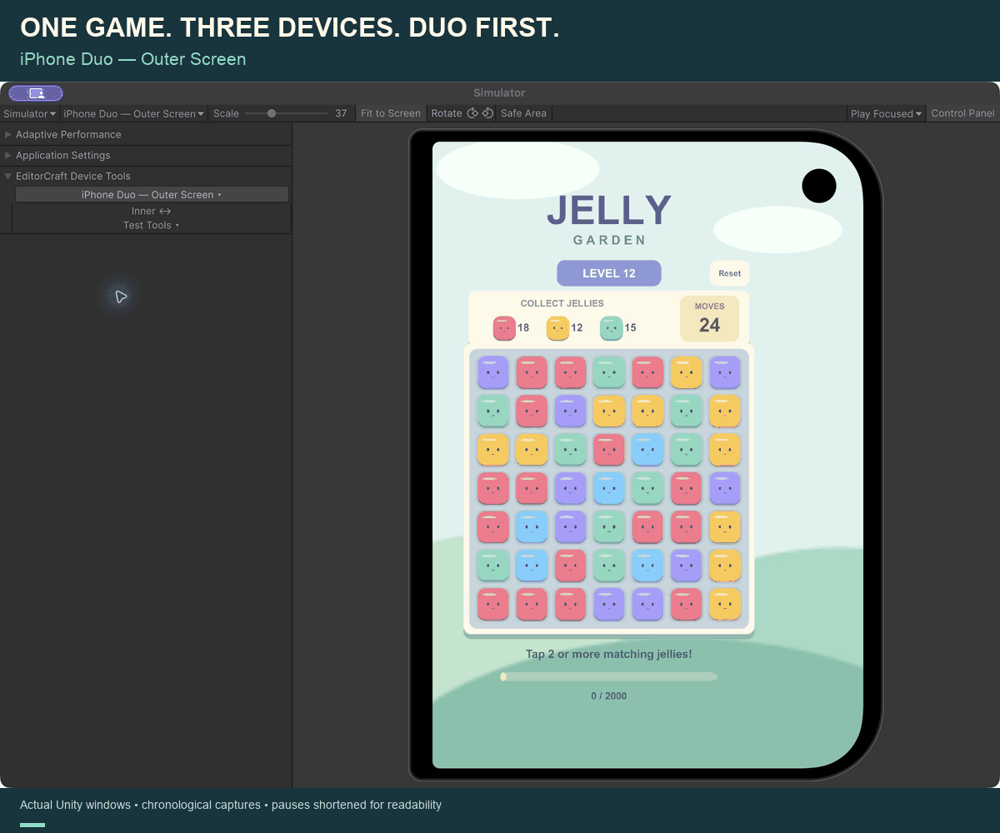
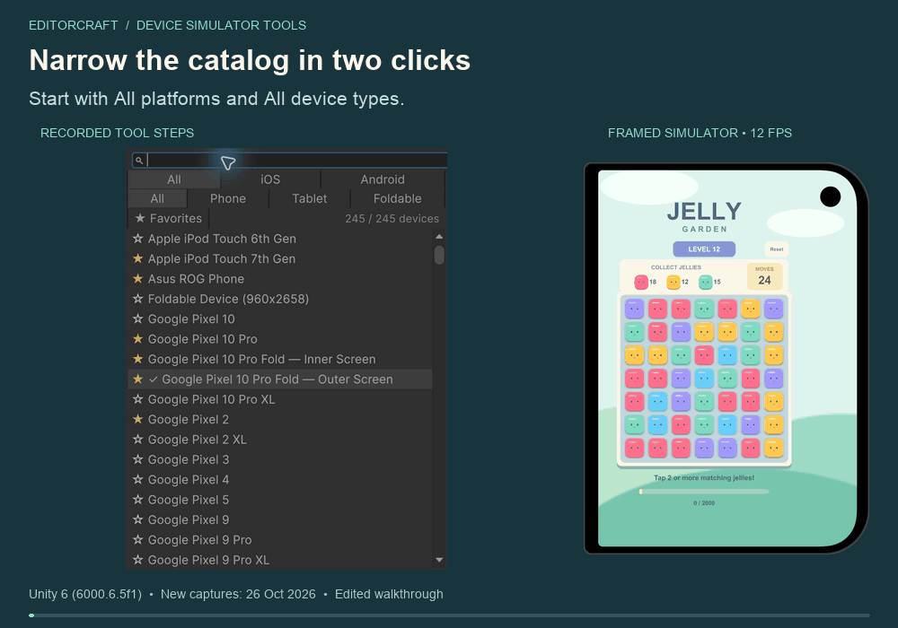
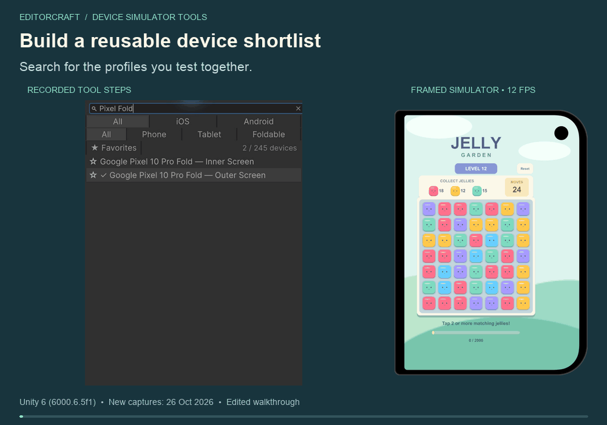
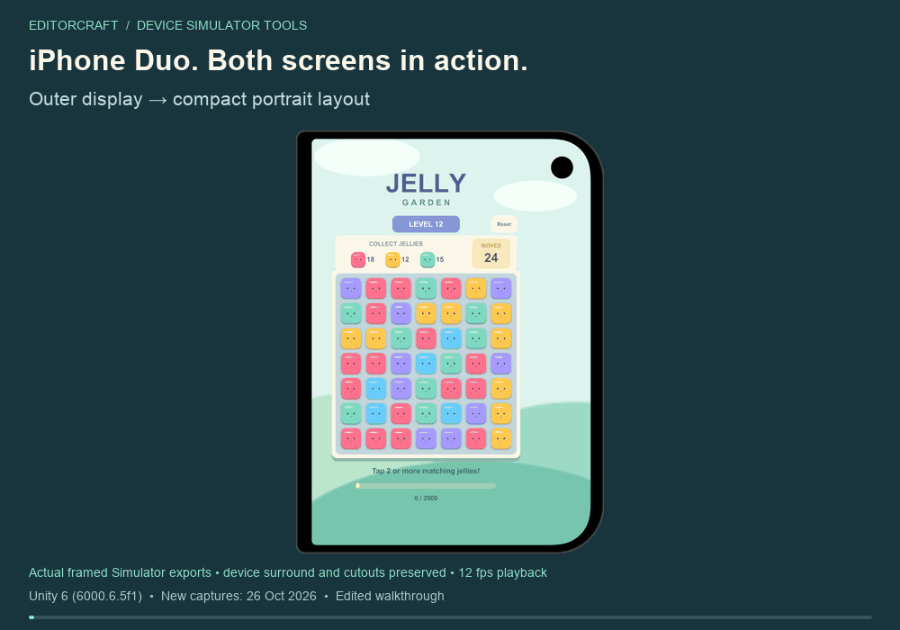
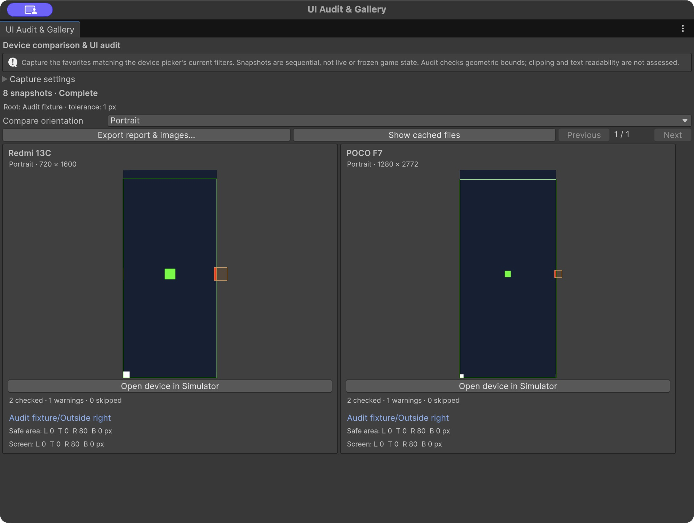
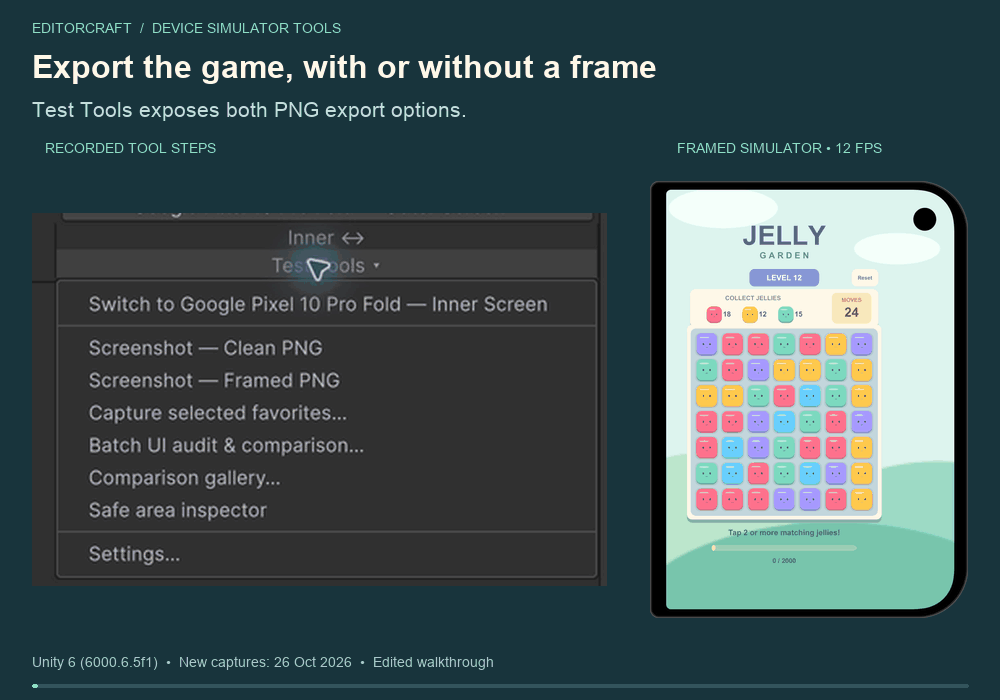
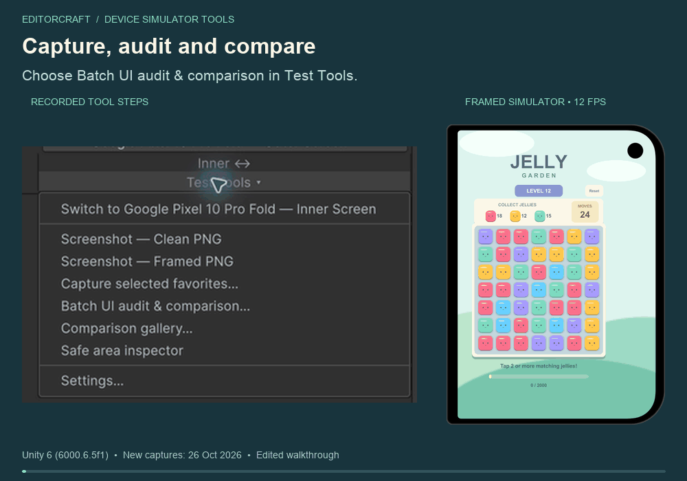

<p align="center">
  
</p>

# EditorCraft · Device Simulator Tools

**Find the right device. Check your game's layout. Capture and compare.**

A focused toolkit inside Unity's Device Simulator: searchable devices, favorites,
foldable screen switching, clean/framed PNGs, safe-area inspection and batch UI audits.
Built by [Daghan Demirci](https://github.com/dghn).

**181 maintained profiles · 6 foldable pairs · Editor-only tooling**
Tested tool versions: **Unity 2022.3.62f2** and **Unity 6000.6.5f1**.

[Install](#get-started) · [Try the puzzle](#play-with-jelly-garden) ·
[Features](#the-workflow) · [Device list](Documentation~/DEVICES.md) ·
[Compatibility](#compatibility)

## Get started

In **Package Manager → + → Install package from Git URL**, paste:

```text
https://github.com/dghn/editorcraft-device-simulator-tools.git#v0.4.2
```

Open **Window → General → Device Simulator → Control Panel → EditorCraft Device Tools**.
The device button opens the picker; **Test Tools** contains capture and audit commands.
Keep Simulator active and rendering when capturing.

Git must be installed. No GitHub account, SSH key, Unity CLI or Pipeline package is
needed. UPM resolves the Unity device catalog, Newtonsoft JSON and uGUI dependencies.

**Working from this checkout?** Install its `package.json` with **Install package
from disk** in an existing Unity project. This repository is a UPM package, not a
standalone Unity project. The optional Jelly Garden sample and refreshed iPhone Duo showcase are included
in **v0.4.2**.

[Agent-friendly installer](Documentation~/AGENT_INSTALL.md) ·
[Installation verification](Documentation~/INSTALL_VERIFICATION.md) ·
[Released v0.4.2](https://github.com/dghn/editorcraft-device-simulator-tools/releases/tag/v0.4.2)

## Play with Jelly Garden

**iPhone Duo is the lead showcase device:** the gameplay and screen-switch demos
below use its real inner/outer profiles and device surrounds.



A small **playable tap-to-pop puzzle**, with soft scenery, animated jellies, collection
goals, falling tiles and a move limit. Tap matching groups, collect all three targets,
and reset to replay the seeded board. Portrait and foldable layouts respect the
safe area; wide landscape layouts put the goals beside the board.

In Package Manager, select this local package and **Samples → Jelly Garden → Import**.
Open `JellyGarden.unity` from the imported sample and press **Play**. All sample art is
procedural; there are no external game assets or SDKs.

For an audit, select `Jelly Garden/Safe area/Game` as the UI root. The full-screen
scenery intentionally extends outside the safe area. The sample is optional runtime
content; it enters your `Assets` folder only when imported.

## The workflow

### 1. Find and keep your test devices

Search by model, combine **iOS / Android** with **Phone / Tablet / Foldable**, and star
the screens you test most. Favorites, search and filters persist locally. Arrow keys
navigate the list; Enter selects. Maintained profiles take precedence over duplicate
bundled names without modifying Unity's catalog.

Duo leads the tour: outer → inner → landscape → Pixel Fold inner/outer → iPhone 16 → Duo.
The picker and Simulator are recorded in the same session; the visible device changes with the selection.



<details>
<summary>Platform/type filtering and favorites</summary>





Favorites still honor the current search and filters. A batch operates on that
matching shortlist, not every starred device.

</details>

### 2. iPhone Duo: check both screens

Switch paired displays with **Inner ↔ / Outer ↔**. Use the **Safe area inspector** for
one selected RectTransform, or **Batch UI audit & comparison…** for a whole UI root.
The audit reports per-edge screen/safe-area overflow, supports exclusions and tolerance,
and lets you jump from an issue to its scene object and device.



<details>
<summary>Additional device coverage: Pixel Fold and iPhone 16 audit</summary>

The audit gallery uses **clean screen captures** so its boundary guides align with
screen pixels. Device surrounds are preserved in the framed gameplay GIFs and PNGs.



Fresh sample check: **3 profiles · 11 recorded orientations · 329 UI objects per
snapshot · 0 geometric warnings · 0 skipped objects**, in Unity **6000.6.5f1**.
This is a layout-bounds result, not a guarantee of readability or physical-device accuracy.

[Audit usage and limits](Documentation~/UI_AUDIT.md) ·
[Actual sample report](Documentation~/assets/demos/puzzle-audit/report.json)

</details>

### 3. Capture and compare

Export a **Clean PNG** at the simulated screen resolution or a **Framed PNG** with
the device surround and transparent exterior. **Capture selected favorites…** produces
an HTML gallery and a PNG per matching screen. **Settings…** remembers separate
image/gallery destinations; output names are timestamped and collision-safe.

For deeper review, use the native **Comparison gallery…**: up to four snapshots per
page, an orientation filter, and HTML/JSON/full-resolution PNG export. Audit and
comparison share the same sequential capture runner. Completion or cancellation
restores the original device and orientation and retains completed captures.

<details>
<summary>PNG export and batch comparison walkthroughs</summary>





</details>

[Clean PNG](Documentation~/assets/demos/puzzle-clean.png) ·
[Framed PNG](Documentation~/assets/demos/puzzle-framed.png) ·
[Sample audit HTML](https://dghn.github.io/editorcraft-device-simulator-tools/puzzle-audit/) ·
[Framed device gallery](https://dghn.github.io/editorcraft-device-simulator-tools/favorite-gallery/)

These links open the rendered reports directly in your browser, including their PNGs.
[All report previews](https://dghn.github.io/editorcraft-device-simulator-tools/)

## Device coverage

| Maintained catalog | Screen profiles |
| --- | ---: |
| Apple | 89 |
| Android | 92 |
| **Total** | **181** |

These represent **175 model names**, including six paired models: iPhone Duo,
Pixel 10 Pro Fold, Galaxy Z Fold8, Galaxy Z Fold8 Ultra, Galaxy Z Flip8 and OPPO Find N5.
Inner and outer screens are counted separately. Unity's bundled devices and presets
add entries; picker totals vary by Editor and catalog version.

All 181 profile definitions were validated over 676 orientations in each supported
Editor version. Definitions include varying levels of geometry evidence; catalog
coverage is not physical-device testing.

[Device list and geometry notes](Documentation~/DEVICES.md) ·
[All six foldable pairs with fresh puzzle captures](Documentation~/SHOWCASE.md)

## Compatibility

There is **no package-declared minimum Unity version**. Tooling was verified in
**2022.3.62f2** and **6000.6.5f1**; these are tested versions, not requirements.
Earlier Editors may work but have not been verified; Device Simulator APIs and
package dependencies must be available. The new sample and refreshed media
were verified in **6000.6.5f1** on **2026-10-26**.

- Safe areas represent the profile's recorded OS/system-UI configuration.
- Audits measure rectangular bounds; they do not test masks, clipping, overlap or text readability.
- Captures are sequential while the game runs, not a frozen replay or automated visual test.
- Foldables simulate one screen at a time, not hinge motion.

The device tour shows **39 native captures over 31.2 seconds**, with actual device
selection followed by the matching Simulator window. Gameplay and Duo screen switching
use **15 seconds / 180 frames / 12 fps playback** from real framed exports. The other
walkthroughs show recorded UI steps on their own. Playback timing is edited; no
independent gameplay is placed beside the picker.

[Compatibility evidence](Documentation~/PLUGIN_COMPATIBILITY.md) ·
[Capture provenance](Documentation~/SHOWCASE.md#recording-notes)

## Inside the repository

| Path | Purpose |
| --- | --- |
| `Editor/` | Editor-only tooling, device profiles and overlays |
| `Samples~/Jelly Garden/` | Optional playable puzzle scene and source |
| `Documentation~/` | Guides, captures, reports and geometry provenance |
| `Tools~/` | Manifest installer and compatibility probes |
| `.github/` | Integrity validation and contribution templates |

Run `python3 .github/scripts/validate_package.py` and
`python3 -m unittest discover -s 'Tools~' -p 'test_*.py'` from the package checkout.

[Contributing](CONTRIBUTING.md) · [Changelog](CHANGELOG.md)

## License and credits

Original tooling, sample code and procedural sample artwork use [MIT](LICENSE.md).
Manufacturer-derived surrounds and other third-party materials are excluded; see
[Third-party notices](THIRD_PARTY_NOTICES.md).

Independent tooling, not affiliated with Unity or device manufacturers.
